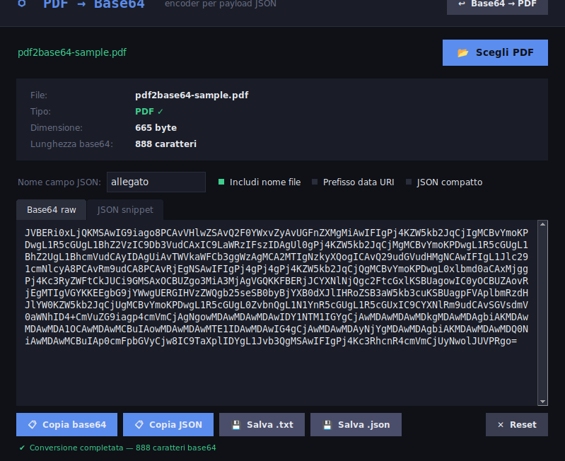

# PDF2Base64

🇬🇧 [English version](README.md)

**Trasforma un PDF in una stringa Base64 pronta da mettere in un JSON — e ritrasforma quel testo in un PDF.**



Alcune API e automazioni (per esempio n8n, Make, Zapier) si aspettano il PDF come stringa Base64 dentro un corpo JSON. PDF2Base64 legge un PDF sul tuo computer e ti dà quella stringa, oppure un oggetto JSON con il nome del campo che scegli tu. Funziona anche al contrario: incolli una stringa Base64, un data URI o un JSON e salvi di nuovo un PDF.

È un solo file Python con una finestra Tkinter. Basta Python: non c'è un `requirements.txt` e non c'è un account. Lo stesso file si usa come finestra o da riga di comando, su macOS, Windows e Linux.

> L'interfaccia è in italiano. Il titolo della finestra è `PDF → Base64 | ISA Digital`.

## Requisiti

- Python 3.10 o successivo. I comandi qui sotto usano `python`. Se sul tuo sistema c'è solo `python3`, usa quello: è lo stesso programma.
- `tkinter`, già incluso negli installer abituali di Python. La riga di comando funziona anche senza.
- Facoltativo: `pip install tkinterdnd2` per trascinare un PDF sulla finestra. Il pulsante del file funziona anche senza.

Clona o scarica questo repository ed esegui `PDF2Base64.py`.

## Come si usa

### Finestra

```bash
python PDF2Base64.py                      # apre la finestra
python PDF2Base64.py --gui documento.pdf  # apre la finestra con il file già caricato
```

1. Scegli un PDF con **Scegli PDF**, oppure premi Ctrl+O (⌘O su Mac). Se è installato `tkinterdnd2` puoi trascinare un file sulla finestra. Se ne trascini più di uno, viene caricato solo il primo.
2. Controlla che `%PDF-` compaia nei primi 1024 byte. Se non c'è, la finestra chiede conferma prima di convertire.
3. La codifica avviene in background, così la finestra non si blocca. Una stringa lunga viene mostrata fino a 20.000 caratteri. **Copia** e **Salva** usano sempre il testo intero.
4. Due schede:
   - **Base64 raw** — la stringa Base64 semplice;
   - **JSON snippet** — un oggetto JSON. Il nome del campo si può modificare e all'inizio è `allegato`.
5. Tre opzioni, applicate mentre le cambi:
   - **Includi nome file** — aggiunge `"_filename"` (attiva di default);
   - **Prefisso data URI** — mette `data:application/pdf;base64,` davanti alla stringa;
   - **JSON compatto** — una riga sola, senza indentazione.
6. **Copia base64**, **Copia JSON**, **Salva .txt**, **Salva .json** (Ctrl+S / ⌘S) e **Reset**.
7. **Base64 → PDF** apre una seconda finestra. Incolla una stringa Base64, un data URI o un JSON, oppure apri un file `.txt` / `.json`, poi salva il PDF. Sono accettati spazi, a capo e un padding `=` mancante, e anche l'alfabeto URL-safe (`-` e `_`). In un JSON la finestra usa il nome del campo impostato in **Nome campo JSON**. Se quel nome non c'è, decodifica la stringa più lunga. Il nome del file viene preso da `_filename`, `filename`, `file_name`, `nome_file`, `nomefile` o `name`, se una di queste chiavi c'è. Se il risultato non sembra un PDF, la finestra chiede conferma prima di salvare.

### Riga di comando

```bash
# PDF → Base64, stampato nel terminale
python PDF2Base64.py documento.pdf

# PDF → file JSON, con il nome del campo che scegli tu
python PDF2Base64.py documento.pdf --json --field attachment -o payload.json

# Le stesse opzioni delle caselle
python PDF2Base64.py documento.pdf --json --compact --data-uri --no-filename

# Base64, data URI o JSON → PDF
python PDF2Base64.py --decode payload.json -o documento.pdf

# Pipe. "-" significa standard input.
cat documento.pdf | python PDF2Base64.py - > documento.b64
python PDF2Base64.py --decode - -o documento.pdf < payload.json
```

`python PDF2Base64.py --help` elenca tutte le opzioni. Se il file non sembra un PDF, la riga di comando avvisa e converte comunque. Su Windows imposta il terminale su UTF-8, così accenti e nomi di file vengono stampati bene. Da riga di comando `--field` si usa solo se lo passi: senza, un JSON viene decodificato dalla stringa più lunga.

## Esempio di output

**Base64 raw**

```
JVBERi0xLjQKJeLjz9MK...
```

**JSON snippet**, con il campo predefinito e il nome del file:

```json
{
  "allegato": "JVBERi0xLjQKJeLjz9MK...",
  "_filename": "document.pdf"
}
```

Cambia `allegato` con la chiave che si aspetta la tua API.

## Privacy

PDF2Base64 non fa richieste di rete e non ha un server. Legge il file che scegli e scrive solo dove salvi, o nel terminale. La stringa Base64 è l'intero PDF: un JSON copiato va trattato come il file.

## Limiti noti

- Pulsanti ed etichette sono in italiano.
- Il trascinamento richiede il pacchetto facoltativo `tkinterdnd2`.
- Il testo a video si ferma a 20.000 caratteri. Copia e salva no.
- Il controllo PDF cerca `%PDF-` nei primi 1024 byte. Non analizza il resto del file.
- In un JSON vince il campo indicato e, in mancanza, viene decodificata la stringa più lunga. Imposta il nome del campo quando il file sta accanto a un testo più lungo.

## Sviluppo

```bash
python -m unittest -v
```

I test coprono la codifica, l'oggetto JSON, la decodifica (Base64 semplice, data URI, Base64 URL-safe, padding mancante, JSON) e la riga di comando. Chiamano la conversione direttamente, quindi girano senza aprire la finestra e senza Tkinter.

GitHub Actions esegue lo stesso comando su Ubuntu, macOS e Windows, con Python 3.10 e 3.13. Il workflow è [`.github/workflows/tests.yml`](.github/workflows/tests.yml).

```
PDF2Base64.py                 il programma: codifica, decodifica, finestra, riga di comando
test_PDF2Base64.py            test automatici
docs/screenshot.png           una cattura precedente della finestra
assets/hero.png               la cattura della finestra usata in cima a questa pagina
.github/workflows/tests.yml   test a ogni push e pull request
```

Per contribuire leggi [CONTRIBUTING.md](CONTRIBUTING.md).

## Licenza

[MIT](LICENSE) © Andrea Sportello

---

Se PDF2Base64 ti ha risparmiato un po' di copia e incolla, una ⭐ al repository aiuta altre persone a trovarlo. Problemi e idee sono benvenuti nelle [issue](https://github.com/andrea6687/PDF2Base64/issues).
