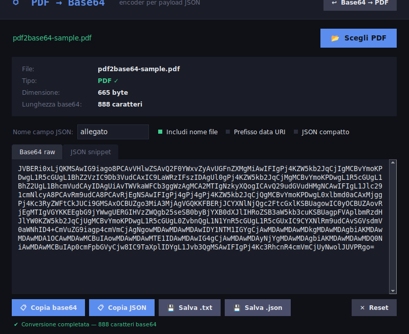

# PDF2Base64

🇮🇹 [Versione italiana](README.it.md)

**Turn a PDF into a Base64 string ready to put in a JSON payload — and turn that text back into a PDF.**



Some APIs and automations (for example n8n, Make, Zapier) expect a PDF as a Base64 string inside a JSON body. PDF2Base64 reads a PDF on your computer and gives you that string, or a JSON object whose field name you choose. The other direction works too: paste a Base64 string, a data URI or a JSON body and save a PDF again.

It is one Python file with a Tkinter window. Python is enough: there is no `requirements.txt` and no account. The same file works as a window or from the command line, on macOS, Windows and Linux.

> The interface is in Italian for now. The window title is `PDF → Base64 | ISA Digital`.

## Requirements

- Python 3.10 or newer. The commands below use `python`. If your system only has `python3`, use that: it is the same program.
- `tkinter`, included with the usual Python installers. The command line works without it.
- Optional: `pip install tkinterdnd2` to drop a PDF onto the window. The file button works without it.

Clone or download this repository and run `PDF2Base64.py`.

## How to use it

### Window

```bash
python PDF2Base64.py                      # open the window
python PDF2Base64.py --gui document.pdf   # open the window with a file already loaded
```

1. Pick a PDF with **Scegli PDF**, or press Ctrl+O (⌘O on a Mac). With `tkinterdnd2` installed you can drop a file on the window. Several files at once: only the first is loaded.
2. It checks that `%PDF-` appears in the first 1024 bytes. If it doesn't, the window asks before converting.
3. Encoding runs in the background, so the window stays responsive. A long string is shown up to 20,000 characters. **Copia** and **Salva** always use the full text.
4. Two tabs:
   - **Base64 raw** — the plain Base64 string;
   - **JSON snippet** — a JSON object. The field name is editable and starts as `allegato`.
5. Three options, applied as you change them:
   - **Includi nome file** — adds `"_filename"` (on by default);
   - **Prefisso data URI** — puts `data:application/pdf;base64,` in front of the string;
   - **JSON compatto** — one line, no indentation.
6. **Copia base64**, **Copia JSON**, **Salva .txt**, **Salva .json** (Ctrl+S / ⌘S) and **Reset**.
7. **Base64 → PDF** opens a second window. Paste a Base64 string, a data URI or a JSON body, or open a `.txt` / `.json` file, then save the PDF. Spaces, line breaks and a missing `=` padding are accepted, and so is the URL-safe alphabet (`-` and `_`). In a JSON body the window uses the field name currently set in **Nome campo JSON**. If that name is absent, it decodes the longest string. A file name is taken from `_filename`, `filename`, `file_name`, `nome_file`, `nomefile` or `name` when one of those keys is present. If the result does not look like a PDF, the window asks before saving.

### Command line

```bash
# PDF → Base64, printed to the terminal
python PDF2Base64.py document.pdf

# PDF → JSON file, with your own field name
python PDF2Base64.py document.pdf --json --field attachment -o payload.json

# The same options as the checkboxes
python PDF2Base64.py document.pdf --json --compact --data-uri --no-filename

# Base64, data URI or JSON → PDF
python PDF2Base64.py --decode payload.json -o document.pdf

# Pipes. "-" means standard input.
cat document.pdf | python PDF2Base64.py - > document.b64
python PDF2Base64.py --decode - -o document.pdf < payload.json
```

`python PDF2Base64.py --help` lists every option. If the file does not look like a PDF, the command line prints a warning and converts it anyway. On Windows it switches the terminal to UTF-8, so accents in messages and file names print correctly. From the command line, `--field` is used only when you pass it: without it, a JSON body is decoded from its longest string.

## Output example

**Base64 raw**

```
JVBERi0xLjQKJeLjz9MK...
```

**JSON snippet**, with the default field name and the file name on:

```json
{
  "allegato": "JVBERi0xLjQKJeLjz9MK...",
  "_filename": "document.pdf"
}
```

Change `allegato` to the key your API expects.

## Privacy

PDF2Base64 makes no network requests and has no server. It reads the file you choose and writes only where you save, or to the terminal. The Base64 string is the whole PDF: treat a copied JSON the same way you would treat the file.

## Known limitations

- Buttons and labels are in Italian.
- Drag and drop needs the optional package `tkinterdnd2`.
- The on-screen text stops at 20,000 characters. Copy and save do not.
- The PDF check looks for `%PDF-` in the first 1024 bytes. It does not parse the rest of the file.
- In a JSON body, the named field wins and otherwise the longest string is decoded. Set the field name when the file sits next to a longer piece of text.

## Development

```bash
python -m unittest -v
```

The tests cover encoding, the JSON object, decoding (plain Base64, data URI, URL-safe Base64, missing padding, JSON) and the command line. They call the conversion directly, so they run without opening the window and without Tkinter.

GitHub Actions runs that command on Ubuntu, macOS and Windows, with Python 3.10 and 3.13. The workflow is [`.github/workflows/tests.yml`](.github/workflows/tests.yml).

```
PDF2Base64.py                 the program: encode, decode, window, command line
test_PDF2Base64.py            automated tests
docs/screenshot.png           an earlier capture of the window
assets/hero.png               capture of the window used at the top of this page
.github/workflows/tests.yml   tests on every push and pull request
```

To contribute, read [CONTRIBUTING.md](CONTRIBUTING.md).

## License

[MIT](LICENSE) © Andrea Sportello

---

If PDF2Base64 saved you some copying, a ⭐ on the repository helps other people find it. Bugs and ideas are welcome in the [issues](https://github.com/andrea6687/PDF2Base64/issues).
