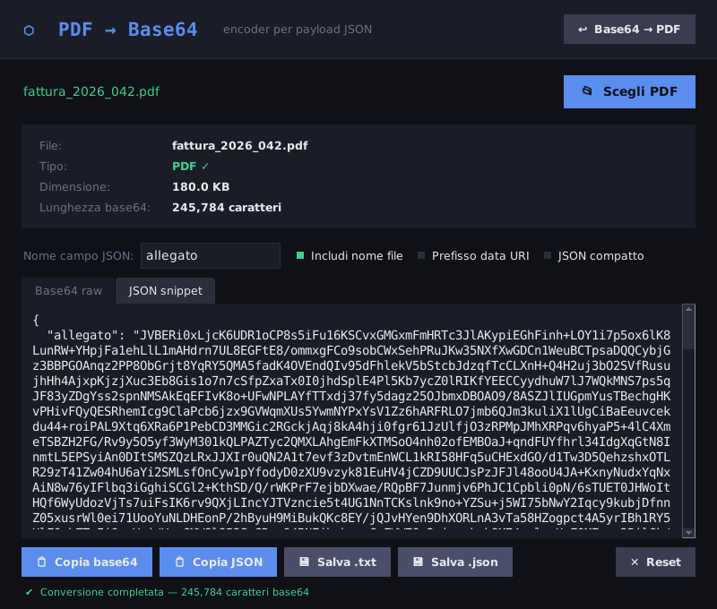

# PDF2Base64

[](https://github.com/andrea6687/PDF2Base64/actions/workflows/tests.yml)
[](LICENSE)

Tool to convert a PDF file into a Base64 string ready to embed in JSON payloads — and back.

Built with Python + Tkinter. No external dependencies. Works as a desktop app or from the command line, on macOS, Windows and Linux.



---

## What it does

1. **Pick a PDF** — file dialog (`Ctrl/⌘+O`), or drag & drop onto the window (optional, see below)
2. **Checks the file** — warns you if the file doesn't look like a real PDF
3. **Encodes to Base64** in the background, so the window never freezes
4. **Shows two outputs**:
   - `Base64 raw` tab — the plain Base64 string
   - `JSON snippet` tab — a ready-to-use JSON object with a configurable field name (default: `allegato`)
5. **Output options**, applied live:
   - **Include filename** — adds `"_filename"` to the JSON (on by default)
   - **Data URI prefix** — prepends `data:application/pdf;base64,`
   - **Compact JSON** — single line, no indentation
6. **Actions**: copy Base64, copy JSON, save as `.txt`, save as `.json` (`Ctrl/⌘+S`), reset
7. **Base64 → PDF** — the reverse operation: paste a Base64 string, a data URI or a whole JSON
   (the Base64 field is found automatically) and save it back as a PDF. Handy to check what an API returned.

Large files are handled smoothly: the window shows a preview of the string, while copy and save always use the full content.

---

## Requirements

- Python 3.10+
- `tkinter` (included in standard Python distributions; only needed for the window, not for the command line)
- Optional: `pip install tkinterdnd2` to enable drag & drop

---

## Usage

### Desktop app

```bash
python PDF2Base64.py                      # open the window
python PDF2Base64.py --gui document.pdf   # open the window with a file already loaded
```

### Command line

```bash
# PDF → Base64 (printed to the terminal)
python PDF2Base64.py document.pdf

# PDF → JSON file with a custom field name
python PDF2Base64.py document.pdf --json --field attachment -o payload.json

# Options: --no-filename  --data-uri  --compact
python PDF2Base64.py document.pdf --json --compact --data-uri

# Base64 / data URI / JSON → PDF
python PDF2Base64.py --decode payload.json -o document.pdf

# Works with pipes too ("-" = standard input)
cat document.pdf | python PDF2Base64.py - > document.b64
```

Run `python PDF2Base64.py --help` for all options.

---

## Output example

**Base64 raw tab:**
```
JVBERi0xLjQKJeLjz9MKNiAwIG9iago8PC9...
```

**JSON snippet tab:**
```json
{
  "allegato": "JVBERi0xLjQKJeLjz9MKNiAwIG9iago8PC9...",
  "_filename": "documento.pdf"
}
```

The JSON field name is editable live in the UI — change `allegato` to any key your API expects.

---

## Tests

```bash
python -m unittest -v
```

---

## Use case

Useful when an API or automation (e.g. n8n, Make, Zapier) expects a PDF embedded as a Base64 string inside a JSON body rather than as a multipart file upload.
